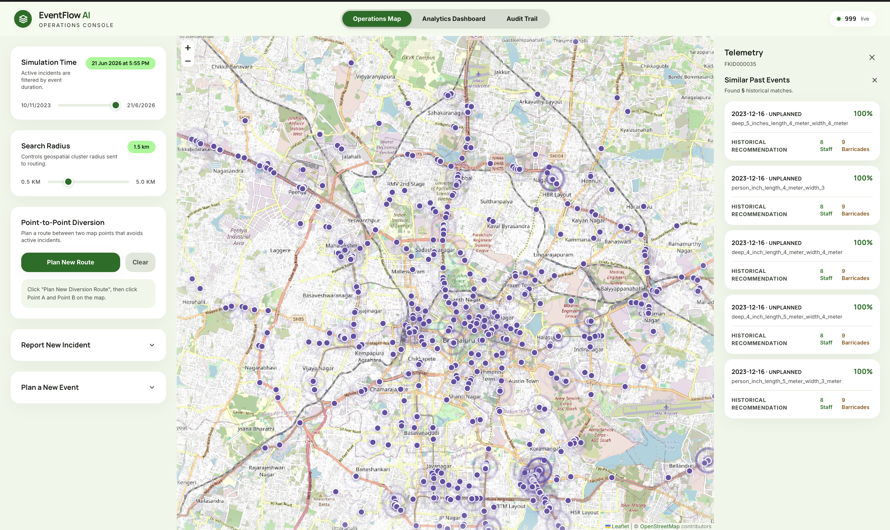
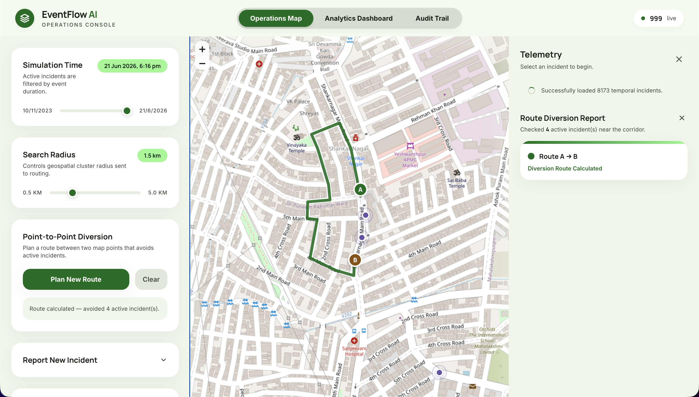
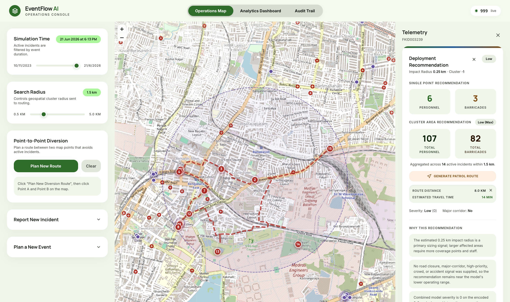
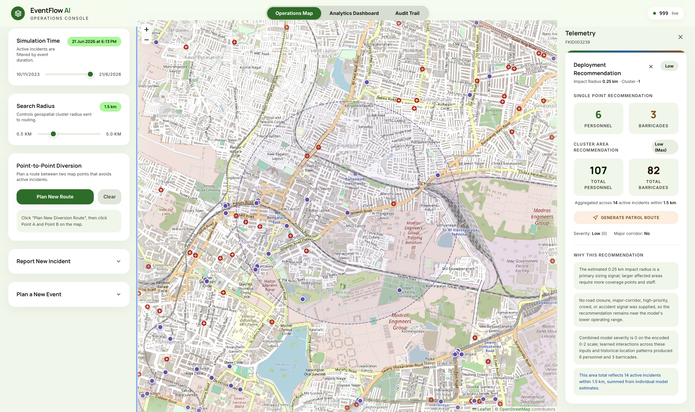
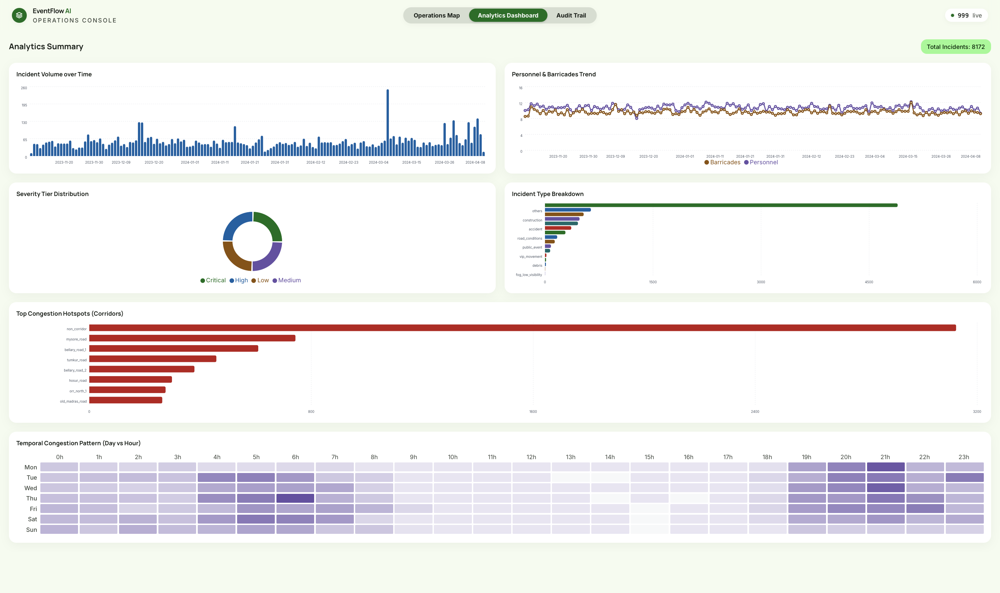
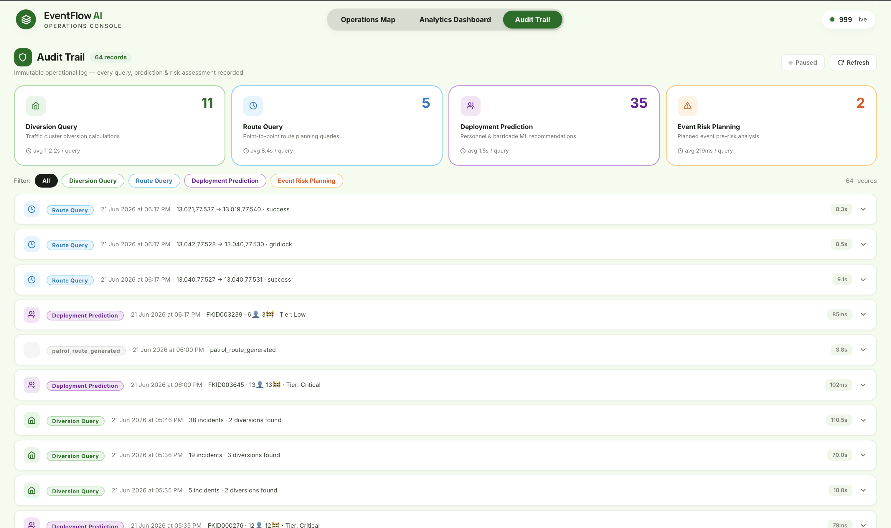

<p align="center">
  
  
  
  
  
  
</p>

<h1 align="center">🚦 EventFlow AI</h1>

<p align="center">
  <strong>AI-Powered Real-Time Traffic Incident Response &amp; Resource Deployment Platform</strong>
</p>

<p align="center">
  <em>An end-to-end full-stack system that combines graph-based diversion routing, ML-powered resource prediction, and real-time spatial analytics to help traffic police operators manage urban incident response across Bengaluru's road network.</em>
</p>

---

## 📋 Table of Contents

- [Overview](#-overview)
- [Core Capabilities](#-core-capabilities)
- [Dashboard Modules](#-dashboard-modules)
- [Dashboard Previews](#-dashboard-previews)
- [API Endpoints](#-api-endpoints)
- [ML Pipeline](#-ml-pipeline)
- [Tech Stack](#-tech-stack)
- [Architecture](#-architecture)
- [Getting Started](#-getting-started)
- [Project Structure](#-project-structure)
- [How It Works](#-how-it-works)

---

## 🎯 Overview

EventFlow AI is a hackathon-grade, production-topology platform built for **traffic incident command centers**. It ingests a real Bengaluru traffic incident dataset (Astram), preprocesses it through a multi-stage ML pipeline, and serves an interactive operator console where police personnel can:

- **Visualize** active incidents on a live temporal map
- **Route** traffic diversions around blocked road segments using real OSM graph data
- **Predict** optimal manpower and barricade deployment using trained RandomForest models
- **Analyze** historical patterns through interactive analytics dashboards
- **Audit** every system action through an immutable Supabase audit trail

The system operates on a single FastAPI backend serving a React frontend, with all ML models and the road network graph loaded into memory at startup for sub-second inference.

---

## 🔥 Core Capabilities

| Capability | Description |
|:---|:---|
| **Real-Time Temporal Map** | Interactive Leaflet map with incident markers that appear/disappear as the operator scrubs through time. Radius-based cluster filtering controls the spatial scope of all operations. |
| **Graph-Based Diversion Routing** | Downloads and caches Bengaluru's 12 km drive-type road network via OSMnx. Severs blocked edges at incident locations, then computes macro-flank recovery routes using Dijkstra's algorithm through the damaged graph. |
| **ML Resource Deployment** | Three trained RandomForest models predict recommended personnel count, barricade count, and deployment tier (Low/Medium/High/Critical) for any incident based on 70+ engineered features. |
| **Cluster-Wide Aggregation** | Aggregates deployment predictions across all incidents within the operator's selected radius, providing area-wide resource totals and maximum tier classification. |
| **Patrol Route Optimization** | Solves the Travelling Salesman Problem (TSP) for multi-incident patrol routing using a greedy nearest-neighbor heuristic refined with 2-opt local search on the real road network. |
| **TF-IDF Similarity Search** | Finds the top-5 historically similar incidents using cosine similarity on TF-IDF vectors, boosted by event type and spatial cluster proximity. |
| **Planned Event Risk Scoring** | Pre-event risk index (0–100) with deployment lead time recommendations for festivals, rallies, and public events. |
| **Immutable Audit Trail** | Every diversion query, deployment prediction, patrol route, and risk assessment is logged to Supabase PostgreSQL via fire-and-forget background threads — zero impact on API latency. |
| **Analytics Dashboard** | Time-windowed analytics with incident volume timeseries, cause breakdowns, severity tier distributions, hotspot corridor rankings, and day×hour temporal heatmaps. |

---

## 📊 Dashboard Modules

| # | Module | What it does |
|:---:|:---|:---|
| 1 | **Operations Map** | Interactive Leaflet map with live incident markers, diversion route polylines, patrol route visualization, radius overlay, and point-to-point route display |
| 2 | **Timeline Scrubber** | Temporal slider that filters the entire incident dataset to show only events active at the selected point in time — enables historical replay and simulation |
| 3 | **Radius Control** | Adjustable search radius (km) that defines the spatial cluster for all diversion, deployment, and patrol operations around a selected incident |
| 4 | **Cluster Diversion Engine** | Macro-flank routing: severs all incident edges within the cluster, identifies every approaching road, and computes bypass routes with iterative depth expansion (0→5 intersections) |
| 5 | **Point-to-Point Route Planner** | User clicks Point A and Point B on the map; the engine computes a shortest path that avoids all active incidents within a padded bounding box corridor |
| 6 | **Deployment Predictor** | Per-incident ML prediction: recommended personnel, barricades, deployment tier, severity score, affected radius, and natural-language explanation of the recommendation |
| 7 | **Cluster Deployment Aggregator** | Area-wide resource totals: sums personnel and barricades across all cluster incidents, reports maximum tier, includes all incident IDs for accountability |
| 8 | **Patrol Route Optimizer** | TSP solver for multi-incident patrol routing — greedy nearest-neighbor initialization with 2-opt refinement, outputs total distance, travel time, and ordered visit sequence |
| 9 | **Event Similarity Search** | TF-IDF cosine similarity over the full historical dataset, with event-type and spatial-cluster boosting — returns top-5 matches with their predicted deployments |
| 10 | **Planned Event Risk Assessment** | Pre-event 0–100 risk index computed from ML tier prediction + location frequency penalty + severity penalty + temporal penalty (peak hour / weekend), with deployment lead time recommendation |
| 11 | **Manual Incident Entry** | Form-based incident creation: enter coordinates (or click map), event type, cause, priority, vehicle type, road closure status, corridor, junction, zone, and description — triggers both diversion and deployment simultaneously |
| 12 | **Analytics Dashboard** | Time-windowed visualizations: incident volume timeseries (daily), incident type breakdown (pie/bar), severity tier distribution, top-8 hotspot corridors, average personnel/barricade trends, day-of-week × hour-of-day heatmap |
| 13 | **Audit Trail Dashboard** | Paginated, filterable view of all immutable audit records from Supabase — aggregate stats (total counts per event type, average response times), full payload inspection |
| 14 | **Error Boundary** | React error boundary with graceful fallback UI — prevents full-app crashes from individual component failures |

---

## 🖼 Dashboard Previews

<div align="center">

| Module | Preview |
|:---:|:---|
| **Operations Map & Timeline** |  |
| **Cluster Diversion & Routing** |  |
| **Patrol Route** |  |
| **ML Resource Deployment** |  |
| **Analytics Dashboard** |  |
| **Audit Trail** |  |

*(Add screenshots of your dashboard to the `assets/screenshots/` folder to populate these placeholders)*

</div>

---

## 🔌 API Endpoints

### Diversion & Routing

| Method | Endpoint | Description |
|:---:|:---|:---|
| `GET` | `/get-dataset` | Returns the raw Astram incident CSV as JSON (all rows with valid lat/lon) |
| `POST` | `/calculate-cluster-diversion` | Accepts a target point + active cluster coordinates. Severs all cluster edges, computes bypass routes for every approaching road. Returns diversion manifest with coordinates. |
| `POST` | `/calculate-route-diversion` | Accepts Point A, Point B, and blocking incidents. Computes a single shortest path that avoids all blocked edges. |
| `POST` | `/optimize-patrol-route` | Accepts a start point + active cluster. Solves TSP with greedy NN + 2-opt. Returns ordered visit sequence, full path coordinates, total distance, and travel time. |

### ML Predictions

| Method | Endpoint | Description |
|:---:|:---|:---|
| `POST` | `/predict-deployment` | Single-incident deployment prediction. Returns recommended personnel, barricades, tier, severity, affected radius, major corridor flag, cluster ID, and natural-language explanation. |
| `POST` | `/predict-deployment-cluster` | Cluster-wide deployment prediction. Returns single-point prediction + aggregated area totals (summed personnel/barricades, max tier, incident count). |
| `POST` | `/similar-incidents` | TF-IDF cosine similarity search over historical incidents. Returns top-5 matches with similarity scores, descriptions, locations, and predicted deployments. |
| `POST` | `/plan-event` | Planned event risk assessment. Returns 0–100 risk index, recommended personnel/barricades, deployment tier, and deployment lead time in hours. |

### Analytics & Audit

| Method | Endpoint | Description |
|:---:|:---|:---|
| `GET` | `/analytics-summary` | Time-windowed analytics: incident volume timeseries, type breakdown, tier distribution, hotspot corridors, personnel/barricade trends, temporal heatmap. |
| `GET` | `/audit-logs` | Paginated audit log retrieval from Supabase. Optional `event_type` filter. |
| `GET` | `/audit-logs/stats` | Aggregate audit stats: total counts per event type, average response times. |
| `GET` | `/health` | Liveness probe. Returns engine and model status. |

---

## 🛠 Tech Stack

### Frontend

| Technology | Version | Purpose |
|:---|:---:|:---|
| React | 18.3 | Component-based SPA framework |
| Vite | 5.4 | Build tool with HMR |
| Leaflet | 1.9 | Interactive map rendering (tile layers, markers, polylines, circles) |
| react-leaflet | 4.2 | React bindings for Leaflet |
| Recharts | 3.8 | Declarative charting library for analytics dashboard |
| TailwindCSS | 3.4 | Utility-first CSS framework |
| Nginx | Alpine | Production static file server + reverse proxy for `/api/*` |

### Backend

| Technology | Version | Purpose |
|:---|:---:|:---|
| FastAPI | 0.115 | Async Python web framework with automatic OpenAPI docs |
| Uvicorn | 0.34 | ASGI server |
| Pydantic | 2.10 | Request/response validation and serialization |
| OSMnx | 2.0 | Downloads and processes OpenStreetMap road networks |
| NetworkX | 3.4 | Graph algorithms (Dijkstra, TSP, ego graphs) |
| pandas | 2.2 | Data manipulation and feature engineering |
| NumPy | 2.2 | Numerical computation |
| scikit-learn | 1.6 | ML models (RandomForest), TF-IDF, DBSCAN, LabelEncoder |
| joblib | 1.4 | Model serialization and loading |
| holidays | 0.63 | Indian public holiday detection |
| haversine | 2.9 | Geographic distance calculations |

### Infrastructure

| Technology | Purpose |
|:---|:---|
| Docker Compose | Multi-container orchestration (backend + frontend/Nginx) |
| Supabase (PostgreSQL) | Immutable audit log storage (JSONB payloads) |
| OpenStreetMap | Road network source data for diversion routing |

---

## 🏗 Architecture

```
┌─────────────────────────────────────────────────────────────────────┐
│                        Docker Compose Network                       │
│                                                                     │
│  ┌───────────────────────┐       ┌────────────────────────────────┐ │
│  │   Frontend Container  │       │      Backend Container         │ │
│  │                       │       │                                │ │
│  │  React 18 SPA (Vite)  │       │  FastAPI (Uvicorn :8000)       │ │
│  │  ├─ Operations Map    │       │  ├─ Diversion API              │ │
│  │  ├─ Timeline Scrubber │ Nginx │  ├─ Deployment API             │ │
│  │  ├─ Route Planner     │──────▶│  ├─ Similarity API             │ │
│  │  ├─ Incident Form     │ /api/*│  ├─ Patrol API                 │ │
│  │  ├─ Analytics Dash    │       │  └─ Analytics API              │ │
│  │  └─ Audit Trail       │       │                                │ │
│  │                       │       │  ┌──────────────────────────┐  │ │
│  │  Leaflet · Recharts   │       │  │  Graph Engine (in-mem)   │  │ │
│  │  TailwindCSS          │       │  │  OSMnx + NetworkX        │  │ │
│  └───────────────────────┘       │  │  12km Bengaluru road net │  │ │
│         :5173                    │  └──────────────────────────┘  │ │
│                                  │                                │ │
│                                  │  ┌──────────────────────────┐  │ │
│                                  │  │  ML Prediction Engine    │  │ │
│                                  │  │  3× RandomForest models  │  │ │
│                                  │  │  TF-IDF Similarity       │  │ │
│                                  │  │  70+ engineered features │  │ │
│                                  │  └──────────────────────────┘  │ │
│                                  │                                │ │
│                                  │  ┌──────────────────────────┐  │ │
│                                  │  │  Audit Logger            │  │ │
│                                  │  │  Fire-and-forget threads │──┼─┼──▶ Supabase
│                                  │  └──────────────────────────┘  │ │   (PostgreSQL)
│                                  └────────────────────────────────┘ │
└─────────────────────────────────────────────────────────────────────┘
                                    │
              ┌─────────────────────┘
              ▼
   ┌─────────────────────┐      ┌──────────────────────────────┐
   │   OpenStreetMap      │      │   ML Training Pipeline       │
   │   Road Network API   │      │   preprocess.py              │
   │   (one-time download │      │   prepare_deployment_dataset │
   │    at startup)       │      │   train_deployment_models    │
   └─────────────────────┘      └──────────────────────────────┘
```

---

## 🚀 Getting Started

### Prerequisites

| Requirement | Minimum Version |
|:---|:---|
| Python | 3.11+ |
| Node.js | 18+ |
| `make` | Any |
| Docker (optional) | 20+ |

### Dataset

Place your Astram incident dataset at `backend/Data/Dataset.csv` before starting. The dataset is gitignored and must contain at minimum: `latitude`, `longitude`, `start_datetime`, `event_type`, `event_cause`, `priority`, `description`.

### Option 1 — Local Development

```bash
# 1. Backend setup
cd backend
python -m venv .venv
source .venv/bin/activate
pip install -r requirements.txt

# 2. Frontend setup
cd ../frontend
npm install

# 3. Run the full ML pipeline (first time only)
cd ..
make pipeline

# 4. Start both servers
make dev
```

- **Backend:** `http://localhost:8000` (+ Swagger docs at `/docs`)
- **Frontend:** `http://localhost:5173`

### Option 2 — Docker Compose

```bash
docker compose up --build
```

Open `http://localhost:5173`. The frontend Nginx container proxies `/api/*` to the backend service. On first boot, the training pipeline runs automatically if model artifacts are not found (~2–5 minutes).

### Environment Variables

Create a `.env` file in the project root for audit logging:

```env
SUPABASE_URL=https://your-project.supabase.co
SUPABASE_KEY=your-anon-or-service-role-key
```

> **Note:** The application works fully without Supabase — audit logging is silently disabled if credentials are missing.

### Supabase Table Setup

Run this SQL once in the Supabase SQL Editor:

```sql
CREATE TABLE audit_logs (
    id          BIGINT GENERATED ALWAYS AS IDENTITY PRIMARY KEY,
    created_at  TIMESTAMPTZ DEFAULT now() NOT NULL,
    event_type  TEXT        NOT NULL,
    payload     JSONB       NOT NULL
);

CREATE INDEX ON audit_logs (event_type);
CREATE INDEX ON audit_logs USING GIN (payload);
```

---

## 📁 Project Structure

```
EventFlowAI/
├── docker-compose.yml                 # Multi-container orchestration
├── Makefile                           # Pipeline & dev server shortcuts
├── .env                               # Supabase credentials
│
├── Data/
│   └── bengaluru_graph.graphml        # Pre-cached OSM road graph (162 MB)
│
├── backend/
│   ├── Dockerfile                     # Python 3.11-slim + GDAL + pip deps
│   ├── docker-entrypoint.sh           # Auto-runs pipeline if models missing
│   ├── requirements.txt               # Python dependencies
│   │
│   ├── app_integrated.py              # FastAPI server — all endpoints
│   ├── deployment_service.py          # ML prediction router (personnel/barricades/tier)
│   ├── analytics_service.py           # Time-windowed analytics router
│   ├── audit_logger.py                # Supabase audit logger (fire-and-forget)
│   ├── inference_features.py          # Real-time feature builder (70+ features)
│   ├── routing_engine.py              # Standalone diversion engine (dev/testing)
│   │
│   ├── preprocess.py                  # Stage 1: Feature engineering pipeline
│   ├── prepare_deployment_dataset.py  # Stage 2: Leakage-safe features + proxy labels
│   ├── train_deployment_models.py     # Stage 3: RandomForest training + evaluation
│   │
│   ├── Data/
│   │   └── Dataset.csv                # Raw Astram incident dataset (gitignored)
│   ├── model_artifacts/               # Trained models + configs (gitignored)
│   ├── feature_metadata.json          # Feature registry from preprocessing
│   └── processed_data.csv             # Engineered feature table
│
└── frontend/
    ├── Dockerfile                     # Node 18 build + Nginx serve
    ├── nginx.conf                     # Reverse proxy config
    ├── package.json                   # React + Leaflet + Recharts + TailwindCSS
    ├── tailwind.config.js             # Custom design tokens
    ├── vite.config.js                 # Vite dev/build config
    ├── index.html                     # SPA entry point
    │
    └── src/
        ├── App.jsx                    # Root component — state orchestration
        ├── main.jsx                   # React DOM entry
        ├── styles.css                 # Global styles
        ├── api/
        │   └── client.js             # HTTP client (fetch wrapper)
        └── components/
            ├── MapView.jsx            # Leaflet map with markers + polylines
            ├── TimelineScrubber.jsx    # Temporal incident filter slider
            ├── RadiusSlider.jsx        # Cluster radius control
            ├── IncidentForm.jsx        # Manual incident entry form
            ├── PlanEventForm.jsx       # Planned event risk form
            ├── RoutePlannerPanel.jsx   # Point-to-point route planner UI
            ├── DiversionResultsPanel.jsx  # Main telemetry/results panel
            ├── DeploymentPanel.jsx     # Personnel & barricade display
            ├── AnalyticsPanel.jsx      # Recharts analytics dashboard
            ├── AuditDashboard.jsx      # Audit trail viewer
            └── AppErrorBoundary.jsx    # React error boundary
```

---

## ⚙️ How It Works

### Diversion Routing Engine

1. **Graph Loading** — At startup, OSMnx downloads (or loads cached) a 12 km drive-type road network centered on Bengaluru (12.9716°N, 77.5946°E) as a NetworkX `MultiDiGraph` with ~12,000 nodes and travel-time edge weights.

2. **Edge Severance** — When an operator selects an incident, the engine severs the road at that point by removing all edges touching the nearest node AND all parallel keys of the nearest edge (both directions). This handles intersection-located incidents (multiple edges converging) and dual-carriageway roads (parallel edges between the same nodes).

3. **Macro-Flank Recovery** — For every road approaching the blocked intersection, the engine attempts Dijkstra shortest-path routing through the damaged graph. If the immediate recovery node is trapped in the dead zone, it expands the search up to 5 intersections outward using `ego_graph` until a reachable target is found.

4. **Point-to-Point Routing** — For A→B routing, all active incidents within a padded bounding box are severed, then a single shortest path is computed between the user's clicked origin and destination.

5. **Patrol TSP** — For multi-incident patrol routing, the engine computes a full distance matrix between all cluster incidents using single-source Dijkstra, solves TSP with greedy nearest-neighbor, then refines with 2-opt local search (reversal of path segments to eliminate crossings).

### ML Prediction Flow

1. **Feature Building** — `DeploymentFeatureBuilder` reconstructs the exact 70+ feature space for a single incoming event using pre-saved artifacts (label encoders, TF-IDF vectorizer, spatial reference points, entity lookup tables). No model is fit at inference time — everything is a lookup or transform.

2. **Model Inference** — The feature vector is scored against three pre-trained RandomForest models to produce personnel count, barricade count, and deployment tier.

3. **Explanation Generation** — A rule-based explanation builder produces human-readable reasoning: "A road closure increases both traffic-control staffing and barricade requirements", "The incident is on a major corridor, increasing control points and diversion complexity", etc.

### Audit Logging

Every API endpoint that performs a computation logs a structured audit record to Supabase via a **fire-and-forget daemon thread**. The calling FastAPI handler returns immediately — the database write never blocks the HTTP response. Each record includes a UUID `audit_id`, ISO timestamp, all input parameters, all model outputs, and the response time in milliseconds.

---

<p align="center">
  <strong>Built for Smart City Hackathons 🏙️</strong>
</p>
